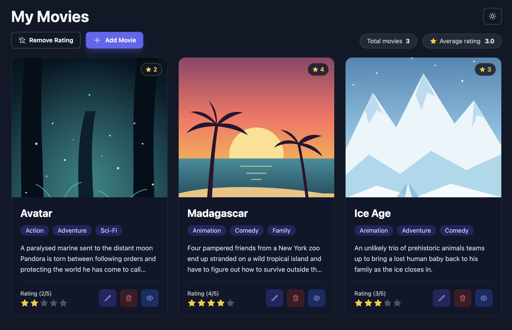
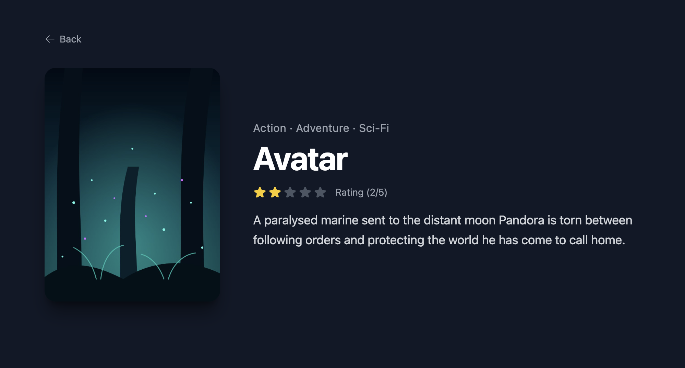

# 📝 Movie App

A movie collection app built with Vue 3, TypeScript and Tailwind CSS.
This app allows users to browse, rate and manage their favorite movies with features such as adding and editing movies, star ratings, a movie detail page and dark mode.
Movies are stored in local storage.

## 🚀 Features
• **Add Movies** – Add a new movie with a title, image URL, genres, description and rating. <br>
• **Edit Movies** – Update the details of an existing movie in the same form. <br>
• **Delete Movies** – Remove a movie after confirming it in a dialog. <br>
• **Star Rating** – Rate movies from 1 to 5 stars, click the same star again to remove the rating. <br>
• **Remove All Ratings** – Reset the ratings of all movies at once. <br>
• **Movie Detail** – Open a separate page with the full poster, genres, rating and description. <br>
• **Stats** – Displays the total number of movies and their average rating. <br>
• **Form Validation** – Required fields and at least one selected genre. <br>
• **Toast Notifications** – Short confirmation after adding, editing or deleting a movie. <br>
• **Data Storage** – All movies and the theme preference are stored locally in the browser. <br>

## 🎨 Design Features
• **Dark / Light Mode** – Switch the theme with a single click, without a flash on page load. <br>
• **Responsive Layout** – Grid of movie cards that adapts from mobile to desktop, full-screen form on mobile. <br>
• **Page Transitions** – Smooth fade and slide between pages, turned off when the user prefers reduced motion. <br>
• **Image Fallback** – A placeholder is shown when a movie poster fails to load. <br>
• **Empty State** – Friendly message when the movie list is empty or a movie is not found. <br>
• **Accessibility** – Native dialogs, keyboard navigation, focus styles and screen reader labels. <br>

## 📱 Screenshots
 

## 🏃🏻 How to Run this App
1. Clone the repository: <br>
    • `git clone https://github.com/DejvCodes/movie-app-vue.git` <br>
    • `cd movie-app-vue` <br>
2. Install dependencies (Node.js 22 or newer): <br>
    • `npm install` <br>
3. Start the development server: <br>
    • `npm run dev` <br>
    • then open the address it prints (e.g. `http://localhost:5173`) <br>

## 💻 Tech Stack
[](https://skillicons.dev)

## 📁 Project Structure
```
src/
├── components/
│   ├── BaseButton.vue         # Reusable button with primary, outline and danger variants
│   ├── ConfirmDialog.vue      # Confirmation dialog for deleting movies and ratings
│   ├── EmptyState.vue         # Message shown when there is nothing to display
│   ├── MovieFormDialog.vue    # Form dialog for adding and editing movies
│   ├── MovieItem.vue          # Movie card in the movie list
│   ├── MoviePoster.vue        # Movie image with a fallback when it fails to load
│   ├── MovieStarRating.vue    # Rating badge on the movie card image
│   ├── StarRating.vue         # Interactive and read-only star rating
│   └── ToastNotification.vue  # Toast message for user actions
├── composables/
│   ├── useDarkMode.ts         # Dark mode state and toggle
│   ├── useMovies.ts           # Movie list state and actions, saved to local storage
│   └── useToast.ts            # Toast message state
├── pages/
│   ├── HomePage.vue           # Movie list with toolbar and stats
│   └── MovieDetailPage.vue    # Detail of a single movie
├── router/
│   └── index.ts               # Routes and page titles
├── types/
│   └── movie.ts               # Movie types
├── App.vue                    # Root component with page transitions
├── constants.ts               # App title and list of genres
├── data.json                  # Default movies
├── main.ts                    # App entry point
└── style.css                  # Tailwind and global styles

public/                        # Favicon and default movie images
images/                        # Screenshots
index.html                     # Main HTML file
package.json                   # Dependencies and scripts
vite.config.mjs                # Vite configuration
tailwind.config.js             # Tailwind CSS configuration
tsconfig.json                  # TypeScript configuration
LICENSE                        # MIT License
```

## 🔐 License
[MIT License](LICENSE)
